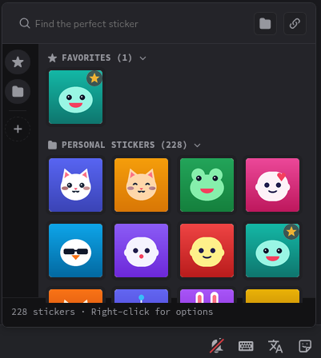
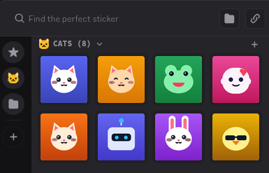
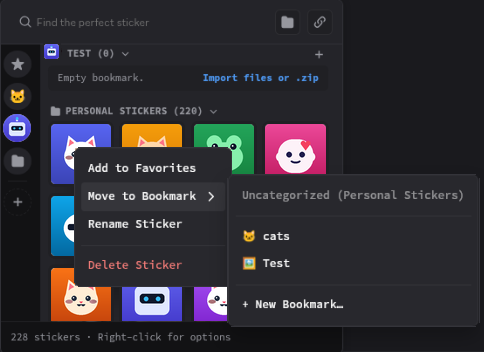
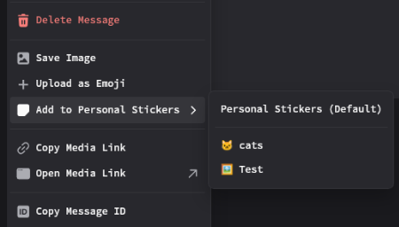
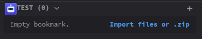

# Personal Stickers (Vencord Userplugin)

A local, unlimited sticker & animated media library for [Vencord](https://github.com/Vendicated/Vencord). Import individual images, videos, or entire `.zip` sticker packs, organize them into custom server-style bookmarks, and send them in any chat as compact, looping GIFs.

---

## 📸 Screenshots

| Compact Popout Picker & Favorites | Custom Bookmarks (Categories) |
| :---: | :---: |
|  |  |

| Sticker Management & Move to Bookmark | Chat Context Menu Integration |
| :---: | :---: |
|  |  |

| Custom Image/Video Bookmark Icons |
| :---: |
|  |

---

## ✨ Features

- **Native-Style Popout Picker**: Opens directly above the chat input bar with smooth scrolling, a search bar, and a compact 4-column grid—just like Discord's native Sticker/Emoji picker.
- **Custom Bookmarks (Categories)**:
  - Organize your stickers into bookmarks displayed in the left sidebar.
  - Customize each bookmark with a **name** and either an **emoji** or a **custom image/video icon** (`.png`, `.ico`, `.jpg`, `.gif`, `.webp`, `.svg`, `.webm`, `.mp4`, etc.).
  - Reorder, edit, or delete bookmarks via right-click context menu.
- **Batch & `.zip` Archive Import**:
  - Import multiple files at once or select a `.zip` archive to automatically extract all supported stickers inside.
  - When importing a `.zip`, you're prompted to optionally create a dedicated bookmark for the pack right away.
- **Right-Click "Add to Personal Stickers"**:
  - Right-click any GIF, image, video, sticker, or custom emoji in chat, the media viewer, or Discord's expression picker to save it directly to your collection (or into a specific bookmark).
- **Favorites**: Star your most-used stickers on hover or via right-click to pin them to the **Favorites** section at the top.
- **Automatic GIF Conversion & Caching**:
  - Converts WebM/MP4 videos and animated/static images into small, looping GIFs (up to `160px` at `20 FPS`) on first use.
  - Caches converted GIFs in local IndexedDB (`VencordPersonalStickers`) so subsequent uses are instant.
- **24/7 Animation Toggle**: Continuous playback of video stickers in the picker is enabled by default and can be toggled in plugin settings (`alwaysAnimate`).

---

## 📦 Supported Formats

- **Stickers**: `.webm`, `.mp4`, `.gif`, `.png`, `.apng`, `.webp`, `.jpg`, `.jpeg`, `.avif`, and `.zip` archives.
- **Bookmark Icons**: Any emoji, or `.png`, `.ico`, `.jpg`, `.jpeg`, `.gif`, `.webp`, `.apng`, `.avif`, `.svg`, `.webm`, `.mp4`.

---

## 🚀 Installation

1. Clone your Vencord source repository if you haven't already:
   ```sh
   git clone https://github.com/Vendicated/Vencord.git
   cd Vencord
   pnpm install
   ```
2. Place the `personalStickers` folder inside `src/userplugins/`:
   ```text
   src/userplugins/personalStickers/
   ├── convertToGif.ts
   ├── index.tsx
   ├── StickerPicker.tsx
   ├── storage.ts
   └── styles.css
   ```
3. Build and inject Vencord:
   ```sh
   pnpm build --dev
   pnpm inject
   ```
4. Restart Discord, open **Settings → Vencord → Plugins**, search for **PersonalStickers**, and enable it.

---

## 💡 Usage

- **Opening the Picker**: Click the sticker icon in the chat bar next to the GIF/Sticker/Emoji buttons.
- **Importing Stickers**:
  - Click the **Folder icon** in the top-right of the picker to import media files or `.zip` packs.
  - Click the **Link icon** to add a direct media URL.
  - Or right-click any media/sticker in Discord and select **Add to Personal Stickers**.
- **Managing Stickers**:
  - **Hover** over a sticker to see its name, file size, and format in the footer, or click the ★ button to favorite it.
  - **Right-click** a sticker to favorite/unfavorite, move it to a bookmark, rename it, or delete it.
- **Managing Bookmarks**:
  - Click the **`+`** button in the left sidebar to create a new bookmark.
  - **Right-click** any bookmark in the sidebar (or its section header) to import files directly into it, edit its name/icon, move it up/down, or delete it.
